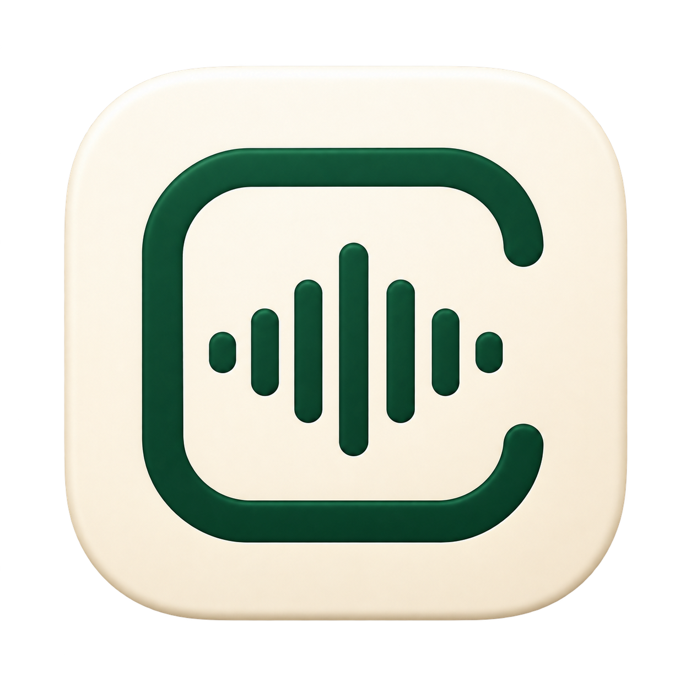
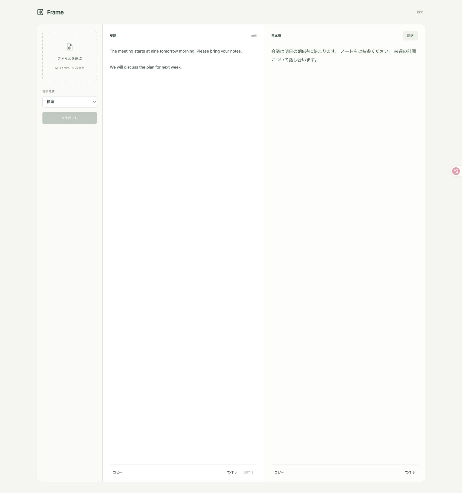

# Frame 文字起こし



**英語のMP3・MP4を文字起こしし、日本語に翻訳するMacアプリ。** ファイルを1つ選べば、長い音声も手作業で分割せずに処理できます。

ライブ字幕は別アプリの **[Frame Live](https://github.com/a24z7km/frame-live)** で提供します。このリポジトリだけでFrame文字起こしをセットアップできます。



## 動作環境・セットアップ

- Apple Silicon Mac、macOS 15以降（Intel Macは未検証）。
- Python 3.10以降（確認：3.14）、FFmpeg／ffprobe、Xcode Command Line Tools。
- Homebrewなら `brew install python ffmpeg`。Swiftがなければ `xcode-select --install`。
- 初回のみ依存ライブラリ・音声認識モデル・Appleの英語／日本語翻訳モデルの取得にネット接続が必要です。

```sh
git clone https://github.com/a24z7km/frame-transcribe.git
cd frame-transcribe
./setup.command
```

`~/Applications/Frame 文字起こし.app` を作成します。翻訳用の補助アプリはリポジトリ内でビルドされます。Frame Liveのインストールは不要です。有料のApple Developer契約、翻訳APIキー、翻訳利用料は不要です。

アプリはこのフォルダを参照します。移動・削除せずに残してください。移動した場合は新しい場所でセットアップをやり直してください。

## 使い方

1. Applicationsの「Frame 文字起こし」を開くと、ブラウザ画面が表示されます。
2. 英語のMP3または音声入りMP4（最大4GB）を選択・ドロップします。
3. 標準（Tiny English）または高精度（Base English）を選んで開始します。
4. 結果を編集・コピーし、TXTやSRTを保存します。
5. 「翻訳」で日本語訳を作成し、編集・コピー・`.ja.txt`保存できます。

Apple翻訳の初回画面で、英語と日本語のモデルを準備してください。ダウンロード完了をアプリが待ってから翻訳します。「翻訳モデルを準備」で先に準備することもできます。

30分の音声もそのまま選べます。音声は内部で5分ずつデコードし、翻訳は文の区切りを考慮して自動で分け、元の順番で結合します。英文の上限は2MBです。SRTは認識時の時間区間、TXTは編集後の文章を書き出します。

ランチャーの画面は `http://127.0.0.1:18764/` です。手動で `./start.command` を実行すると `http://127.0.0.1:8765/` で開きます。手動起動の終了はCtrl+Cです。

## ブックマークから起動

セットアップ後、ブラウザのブックマークのURL欄に `frame-transcribe://open` を手入力します。「Frameを開く」確認では開くを選びます。ライブ字幕の起動・音声取得はこのアプリでは行いません。

## データと制約

[faster-whisper](https://github.com/SYSTRAN/faster-whisper)の英語専用モデルをCPU int8で実行し、[Apple Translation](https://developer.apple.com/documentation/translation)で端末内翻訳します。モデル取得後はオフラインで処理でき、音声や翻訳本文を外部翻訳サービスへ送るフォールバックはありません。AppleのAPI利用状況・性能情報の扱いはAppleのドキュメントを参照してください。

入力の一時コピーは処理完了・エラー・中止時に削除します。直近の原文と訳文はサーバー稼働中だけメモリに保持し、再読み込みすると復元します。ブラウザ内の未保存の編集は復元されません。必要な結果は終了前に保存してください。マイク・画面収録権限は不要です。

小型モデルは固有名詞・雑音・訛りで誤認識します。5分の境界で文脈が途切れる場合があります。30分の実音源全体の所要時間は未測定です。

## 開発・確認

```sh
.venv/bin/python -m unittest discover -s tests -v
node tests/translation-ui.cjs
zsh native/build.sh
zsh native/build-launcher.sh
```

32,309文字の英文を1回の操作で分割翻訳できること、MP3読込→英語文字起こし→日本語翻訳の連携を確認しました。`requirements.lock.txt`は動作環境のスナップショットです。

主なファイル：`server.py`、`worker.py`、`translation.py`、`dist/`、`native/FrameLauncher.swift`、`native/FrameTranslate.swift`。モデル・仮想環境・ビルド済みアプリ・録音・個人用データはGitに含めません。アイコンは画像生成で作成した波形＋フレーム案です。
