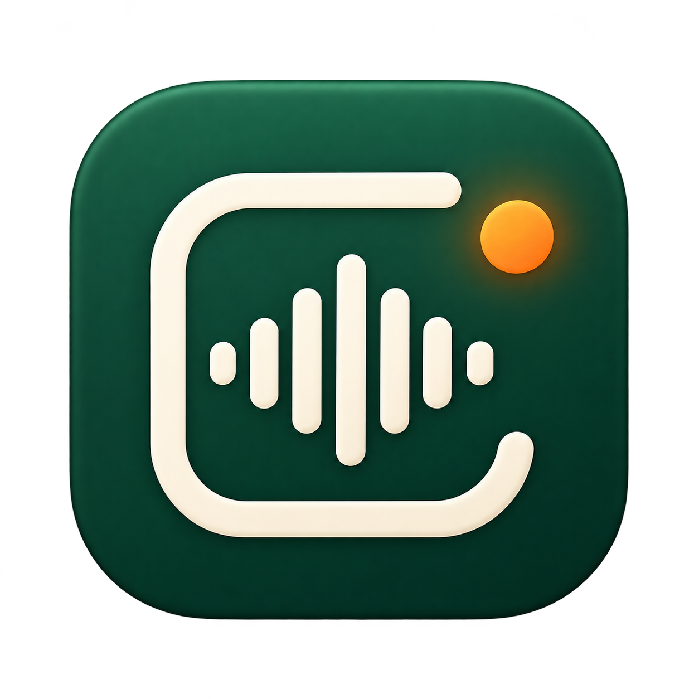
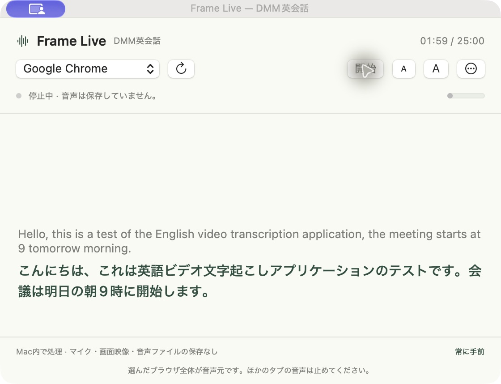

# Frame — ローカル英語文字起こし・日本語翻訳

<p>
  
  
</p>

Mac内で英語の音声を文字起こしし、日本語に翻訳する個人用アプリです。APIキー・有料翻訳API・仮想オーディオドライバは使いません。

- **Frame 文字起こし**：MP3・MP4から英語のTXT／SRTと日本語訳を作成。
- **Frame Live**：ブラウザの再生音声を取り込み、英語と日本語を常に手前の小窓に表示。



## 動作環境

- Apple Silicon搭載Mac、macOS 15以降。Intel Macはビルド・動作未検証です。
- Python 3.10以降（動作確認：3.14）、FFmpeg／ffprobe。
- Xcode Command Line Tools（Swiftコンパイラ）。
- 初回のみネット接続と、音声認識モデル・Appleの英語／日本語翻訳モデルのダウンロードが必要です。

Homebrewを使う場合は `brew install python ffmpeg`、Swiftがなければ `xcode-select --install` で前提ツールを用意します。

## セットアップ

このリポジトリをMac内の好きな場所に取得し、そのフォルダで実行します。

```sh
./setup.command
```

依存ライブラリとTiny Englishモデルを取得し、Swiftアプリをローカルビルドします。`~/Applications/` に次の2つを作成し、アイコンを設定します。

- `Frame 文字起こし.app`
- `Frame Live.app`

有料のApple Developer契約は不要です。Appleの翻訳モデルは初回起動時に画面の案内に従って準備してください。このリポジトリのフォルダはアプリから参照するので、セットアップ後に移動・削除しないでください。移動した場合は新しい場所でセットアップをやり直します。アプリ更新後、macOSが音声取得権限の再設定を求める場合があります。

実行環境の再現用スナップショットは `requirements.lock.txt` です。通常のセットアップは `requirements.txt` を使います。

## ファイルから文字起こし

1. `Frame 文字起こし.app` を開きます。
2. 英語のMP3または音声入りMP4（最大4GB）を選択・ドロップします。
3. Tiny English（軽さ優先）かBase English（精度優先）を選んで開始します。
4. 結果を編集し、コピーまたはTXT／SRT保存します。
5. 「日本語に翻訳」で日本語訳を作り、編集・コピー・`.ja.txt` 保存できます。

30分の音声も手作業の分割は不要です。音声は内部で5分ずつ処理し、英文は文の区切りを考慮して翻訳します。翻訳する英文の上限は2MBです。SRTは認識した元の時間区間、TXTは編集後の文章を使います。

ブラウザ画面はランチャー利用時 `http://127.0.0.1:18764/` です。手動で `./start.command` を起動した場合は `http://127.0.0.1:8765/` で開き、終了はターミナルでCtrl+Cです。

## ライブ字幕

1. `Frame Live.app` を開きます。
2. 初回は「音声取得を許可…」から、Macの「画面とシステムオーディオの収録」でFrame Liveを許可します。求められたら開き直します。
3. DMM英会話などで使うブラウザを選び、「開始」を押します。
4. 「音声を待っています」と表示されたら、ブラウザで音声を再生します。

英語が上、日本語訳が下に表示され、最新の発言と翻訳まで自動スクロールします。上部の小さい「A」／大きい「A」で文字サイズを変更できます。「…」から会話をコピーできます。「停止」で音声取得・認識プロセスを停止し、ウィンドウを閉じると終了します。

- **相手の声など、ブラウザの再生音声が対象です。自分のマイク音声は取得しません。**
- 選んだブラウザ全体の音声が対象です。ほかのタブの音声は止めてください。
- Chrome、Safari、Edge、Arc、Braveを選択できます。実機確認はChromeで行っています。
- 約0.65秒の無音または最大7秒で音声を区切るため、表示には数秒程度の遅れがあります。
- 25分の経過時間を表示しますが、25分で強制終了しません。
- 認識待ちは最大2区間、翻訳待ちは最大4件。追いつかない場合は古い区間をスキップします。会話履歴は直近600件、画面は直近30件です。
- レッスンへのBot参加、ログイン操作、ブラウザ拡張の導入は行いません。

## ブックマークから開く

アプリのセットアップ後、ブラウザのブックマークを作り、URL欄に次を手入力します。

- ファイル文字起こし：`frame-transcribe://open`
- ライブ字幕：`frame-transcribe://live`

ブラウザの「Frameを開く」確認では「開く」を選びます。ファイル文字起こし画面の「ライブ字幕を開く」リンクからも起動できます。

## データの扱いと制約

文字起こしは[faster-whisper](https://github.com/SYSTRAN/faster-whisper)の英語専用モデルをCPU／int8で実行し、翻訳はAppleの[Translationフレームワーク](https://developer.apple.com/documentation/translation)を利用します。モデル準備後は端末内で処理し、外部翻訳サービスへのフォールバックはありません。

ファイル文字起こしの一時入力は完了・エラー・中止時に削除します。直近の原文と訳文はサーバー稼働中だけメモリに保持し、ページを再読み込みすると復元します。ブラウザ内の未保存の編集は復元されません。ライブ字幕は音声ファイルを保存せず、マイクと画面映像の出力は使いません。必要な文章は終了前に保存してください。

小型モデルのため、固有名詞・雑音・訛りで誤認識します。ファイル処理の5分境界では文脈が途切れる場合があります。学習の補助として使い、必要な箇所は原音と照らし合わせてください。AppleによるAPI利用状況・性能情報の収集についてはAppleのドキュメントを確認してください。

## 開発と検証

```sh
.venv/bin/python -m unittest discover -s tests -v
node tests/translation-ui.cjs
zsh native/build.sh
zsh native/build-live.sh
zsh native/build-launcher.sh
```

- ブラウザの合成音声再生→音声取得→英語認識→Apple翻訳→浮動ウィンドウ表示を実機確認。
- 複数の字幕による自動スクロール、文字拡大・縮小後の最終訳文の表示を実機確認。
- 32,309文字の英文の分割翻訳、25分相当の入力でのバッファ上限、無音・短い応答の処理を確認。
- DMMの実レッスン25分全体の検証、30分の実音源全体の所要時間測定は未実施です。

ソースとアイコンを公開し、モデル・仮想環境・ビルド済みアプリ・録音・個人用の出力・Macの権限画面は含めていません。アイコンは画像生成で制作した案01です。

主なファイル：`server.py`（HTTP）、`worker.py`（ファイル認識）、`live_worker.py`（逐次認識）、`translation.py`（翻訳制御）、`dist/`（画面）、`native/`（Macアプリとビルド）。
